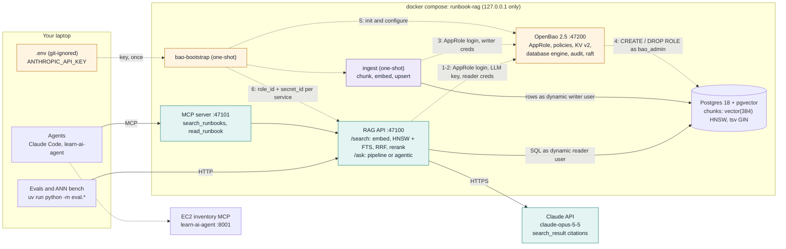

# Learn RAG and vector search (with secrets in OpenBao)

A small, production-shaped RAG system over a realistic corpus: 26 EC2 operations runbooks, policies,
guides and postmortems for the same fleet as the `learn-ai-agent` lakehouse. Read the lessons in order;
each points at the code it explains, and every piece runs locally.



Numbered secret flows are explained in [docs/09-architecture.md](docs/09-architecture.md).

## Lessons

| # | Lesson | You learn |
|---|---|---|
| 00 | [Where RAG fits](docs/00-where-rag-fits.md) | RAG vs long context vs fine-tuning; pipeline vs agentic retrieval |
| 01 | [Embeddings and vector search](docs/01-embeddings-and-vector-search.md) | Embeddings, distance, HNSW, quantisation, pgvector vs vector DBs |
| 02 | [Chunking and ingestion](docs/02-chunking-and-ingestion.md) | Chunking strategies, idempotent ingestion, schema |
| 03 | [Hybrid search and reranking](docs/03-hybrid-search-and-reranking.md) | Full-text + vectors, RRF, cross-encoders, filters |
| 04 | [Evaluating retrieval](docs/04-evaluating-retrieval.md) | Golden sets, recall/MRR/nDCG, answer checks, measured results |
| 05 | [Generation with citations](docs/05-generation-and-citations.md) | Grounded answers with Claude, native citations, failure modes |
| 06 | [Agentic retrieval and MCP](docs/06-agentic-retrieval-and-mcp.md) | Retrieval as a tool, agent loops, MCP server for other agents |
| 07 | [Secrets with OpenBao](docs/07-secrets-with-openbao.md) | Why OpenBao over Vault, seals, auth, policies, dynamic DB credentials, leases |
| 08 | [Production checklist](docs/08-production-checklist.md) | What's done here and what you'd add at work |
| 09 | [Architecture](docs/09-architecture.md) | One diagram of everything |

## Hands-on labs

[lab/](lab/README.md) has eight labs, one component per sitting, in data-flow order: OpenBao, dynamic database
users, ingest, pgvector, hybrid search, retrieval evals, cited answers, agents and MCP. Each one has you predict,
run, check against recorded answers, then break something and fix it. Start with the fresh-start sequence at the
top of [lab/README.md](lab/README.md).

## Run it

Needs Docker (about 2.5 GB of memory for this stack), [mise](https://mise.jdx.dev) for Python 3.13, uv and the
`bao` CLI. `mise tasks` lists every task.

```bash
cd rag-vector-srch
cp .env.example .env              # put ANTHROPIC_API_KEY in it (optional: everything but /ask works without)
mise install && mise run setup    # host tools and Python deps for evals and labs
mise run up                       # build, then OpenBao + bootstrap, Postgres, ingest, API, MCP; waits until healthy
mise run down                     # stop, keeping data;  mise run reset deletes all volumes
```

Then:

| What | Where |
|---|---|
| Search API, Swagger UI | http://localhost:47100/docs |
| MCP endpoint | http://localhost:47101/mcp |
| OpenBao UI (root token: see lesson 07) | http://localhost:47200/ui |
| Postgres (superuser, local only) | `docker compose exec postgres psql -U postgres -d rag` |

```bash
curl -s localhost:47100/ask -H 'content-type: application/json' \
  -d '{"question": "An i4i Kafka broker got an AWS retirement notice. What do I do?", "mode": "agentic"}' | jq -r .answer

scripts/verify.sh                 # evals + ANN benchmark, then stops the stack
docker compose stop               # stop, keep data;  `down -v` deletes everything including OpenBao
uv run pytest                     # unit tests (chunking, RRF)
```

## Layout

```
corpus/runbooks/     26 markdown documents with front matter (the knowledge base)
sql/                 schema: roles, pgvector + full-text columns, HNSW and GIN indexes
rag/                 settings, OpenBao client, chunking, models, search, generation, API, ingest, bootstrap
mcp_server/          MCP server exposing search_runbooks and read_runbook
openbao/             server config (raft, static auto-unseal, audit) and policies
eval/                golden set, retrieval and answer evals, results/
scripts/             ann_bench.py (ANN trade-offs), verify.sh
lab/                 hands-on labs 01-08, env.sh helpers, MCP client
docs/                the lessons
```
