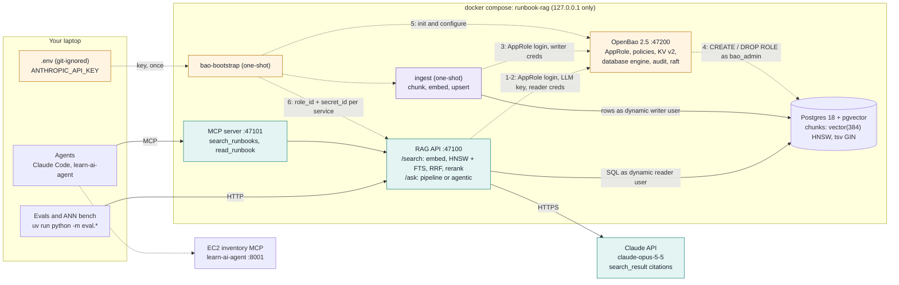

# 09. Architecture

GitHub renders the Mermaid diagram below. Solid arrows carry data; dotted arrows are secrets and
identity (OpenBao), numbered as in the list further down. A richer version is in
[architecture.html](architecture.html): download it and open it in a browser.



The same picture as plain text:

```
 YOUR LAPTOP                     DOCKER COMPOSE · runbook-rag (ports on 127.0.0.1)                          OUTSIDE
┌──────────────────┐   HTTP    ┌──────────────────────────────┐            ┌──────────────────────┐    ┌──────────────┐
│ eval.retrieval   │──────────►│ RAG API (FastAPI) :47100     │──HTTPS────────────────────────────────►│ Claude API   │
│ eval.answers     │           │  /search                     │  key from OpenBao                      │ opus-5-5     │
│ eval.rerankers   │           │   embed (bge-small, 384-d)   │            │ OpenBao 2.5  :47200  │    │ search_result│
│ ann_bench.py ─┐  │           │   HNSW top30 + FTS top30     │ ① ② ┄┄┄┄┄┄►│  auth/approle        │    │ citations    │
└───────────────┼──┘           │   RRF (k=60) → rerank → k    │            │   rag-api, rag-ingest│    └──────────────┘
┌──────────────────┐   MCP     │  /ask  pipeline | agentic    │            │  policies (deny-all  │    ┌──────────────┐
│ Claude Code,     │──►┌─────┐─►└──────────────┬───────────────┘            │   by default)        │    │ EC2 inventory│
│ learn-ai-agent   │   │ MCP │                 │ SQL as v-approle-rag-read-…│  secret/ KV v2       │    │ MCP :8001    │
│ agents ──────────┼───│:47101──────────────────────────────────────────────│   rag/anthropic      │    │ (live facts) │
└──────────────────┘   └─────┘                 ▼                            │  database/           │    └──────────────┘
                       ┌───────────┐   ┌──────────────────────────────┐ ④ ┄┄│   rag-reader  1h     │
                       │ ingest    │──►│ Postgres 18 + pgvector 0.8   │◄┄┄┄┄│   rag-writer 15m     │
                       │ one-shot  │   │  chunks: vector(384) HNSW,   │     │  audit → stdout      │
                       │ chunk,    │   │          tsv GIN (generated) │     │  raft · static seal  │
                       │ embed,    │ ③ │  documents: type, team, svc[]│     └──────────▲───────────┘
                       │ upsert    │┄┄┄┤  roles: rag_reader/_writer,  │                │ ⑤ configure
                       └─────▲─────┘   │  bao_admin, v-approle-* users│     ┌──────────┴───────────┐
                             ┊ ⑥       └──────────────────────────────┘     │ bao-bootstrap        │
                             └┄┄┄┄┄┄┄┄┄┄┄┄┄┄┄ role_id + secret_id ┄┄┄┄┄┄┄┄┄┄┄│ one-shot, idempotent │
                                         (per-service read-only volume)     └──────────────────────┘
 ─── query/ingest data      ┄┄┄ secrets and identity
```

## The secret flows, numbered as in the diagram

1. The API logs in with AppRole (`role_id` + `secret_id` from its own read-only volume) and gets a 1-hour
   token carrying the `rag-api` policy.
2. With that token it reads `secret/rag/anthropic` and requests `database/creds/rag-reader`.
3. The ingest job does the same with `rag-ingest` and gets writer credentials, and no LLM key.
4. OpenBao connects to Postgres as `bao_admin` to `CREATE ROLE … VALID UNTIL …` each user, and drops it
   when the lease ends.
5. `bao-bootstrap` initialises and configures OpenBao on every `docker compose up` (idempotent), and
   rotates `bao_admin`'s password so only OpenBao knows it.
6. It writes a fresh `secret_id` per service; compose mounts only that service's subfolder.

## What was verified on this machine

| Check | Result |
|---|---|
| OpenBao auto-unseals after restart (static seal) | yes, `sealed: false` with no operator action |
| Dynamic Postgres users rotate under load | 4 hours of uptime: a new reader user every 40 to 60 minutes, old ones dropped, `/readyz` shows the live one |
| Audit log records every read of the Anthropic key | 22 reads of `secret/data/rag/anthropic` during the evals, values HMAC'd |
| Incremental ingest | re-run after an interruption: 11 changed, 15 unchanged documents skipped by hash |
| Retrieval, hybrid + rerank | recall@5 0.97, hit@1 0.94 on 32 questions (lesson 04) |
| Answers | citations hit the right document 97% (pipeline) and 100% (agentic); all unanswerable questions declined |
| MCP server | `tools/list` and `search_runbooks` over Streamable HTTP return typed results |

## Where it connects to the other labs

* **learn-ai-agent**: add `http://localhost:47101/mcp` as a second MCP server next to the EC2 inventory
  server, so one agent can answer "which brokers have retirement events, and what do I do?" (lesson 06).
* **agent-evals-observ**: the retrieval and answer evals here are the RAG-specific half of that lab's
  eval suite; its OpenTelemetry tracing is the missing operations piece in lesson 08.
* **argocd-terraform-opentofu**: in production, the OpenBao configuration done by `bao_bootstrap.py`
  would be OpenTofu code using the Vault provider, and these services would be Argo CD applications
  authenticating to OpenBao with the Kubernetes auth method instead of AppRole files.

---

← [08-production-checklist](08-production-checklist.md) · [Index](../README.md)
